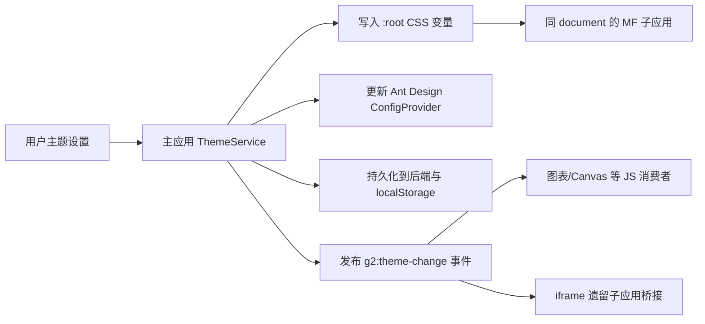

# 自定义主题色系统：颜色归集与需求设计

## 1. 目标

支持租户或用户在主应用中创建、保存、切换任意主题；主题变更应即时传递给所有 G2 子应用。主题不再仅限于“开河蓝”“夜幕黑”，并覆盖页面背景、卡片、文字、边框、输入控件、表格、弹窗、按钮和基础 Ant Design 控件。

本设计的原则是：**子应用只消费语义 Token，主应用是主题唯一写入者**。任何子应用均不得根据主题名称判断颜色，也不得复制一份 `dark.css`。

## 2. 现状与颜色归集

### 2.1 已有基础

主应用当前已经具备主色换肤链路：

- `apps/platforms/pc-chrome/src/skin-theme.ts` 在根文档写入 CSS 变量、持久化主题，并向遗留子应用发送换肤事件。
- `apps/platforms/pc-chrome/src/skin-theme-vars.ts` 维护 Ant Design 3 所需的 `--cube-theme-var--primary-*` 色板，并桥接部分旧组件。
- `apps/platforms/pc-chrome/src/platform.ts` 在主应用初始化时恢复上次主题。

该链路目前主要覆盖“主色”。在 `pc-chrome`、`pc-ui`、`security-monitor` 与 `generic-equipment-monitor` 范围的静态扫描中，仍有 **48 个源码文件**含硬编码颜色；其中出现频率最高的值如下：

| 当前颜色                          | 出现次数 | 现有含义                     | 迁移后的语义 Token                             |
| --------------------------------- | -------: | ---------------------------- | ---------------------------------------------- |
| `#fff`                            |       47 | 卡片、弹窗、输入框、表格背景 | `surface`、`elevated`、`inputBg`、`tableRowBg` |
| `rgba(0,0,0,.85)`                 |       17 | 主文字                       | `text`                                         |
| `#f0f0f0`                         |       16 | 分割线、禁用/浅背景          | `borderSecondary`、`fillQuaternary`            |
| `#1677ff`                         |       14 | 新版主色、链接、焦点         | `primary`、`link`、`focusRing`                 |
| `#1578ff`                         |       10 | Chrome 主色                  | `primary`                                      |
| `#666` / `#8c8c8c` / `#999`       |       22 | 次级文字、占位符             | `textSecondary`、`textTertiary`、`placeholder` |
| `#d9d9d9` / `#e8e8e8`             |       14 | 输入框、表格、卡片边框       | `border`、`borderSecondary`                    |
| `#edf0f5` / `#fafafa` / `#f5f7fa` |       14 | 页面浅背景、表头、悬浮态     | `pageBg`、`tableHeaderBg`、`fillSecondary`     |
| `#f53f3f` / `#ff4d4f`             |       13 | 失败、删除、一级告警         | `danger`、`alarmLevel1`                        |
| `#00BA8B` / `#52c41a`             |       12 | 成功、在线、正常             | `success`、`statusNormal`                      |
| `#FBA33F` / `#fa8c16`             |       12 | 警告、处理中、二级告警       | `warning`、`alarmLevel2`                       |
| `#3662EC` / `#722ed1` 等          |     多处 | 图表序列、业务等级           | `chartSeries*`、`alarmLevel*`                  |

结论：同一十六进制颜色在不同页面承担不同职责，不能机械地全局替换。例如 `#fff` 至少包含页面容器、输入框、弹窗、表格行与按钮文字五类含义，必须按语义拆分。

### 2.2 颜色分层

| 层级         | 归属                             | 是否允许用户修改 | 说明                                                 |
| ------------ | -------------------------------- | ---------------- | ---------------------------------------------------- |
| 品牌色       | `primary` 及派生色阶             | 是               | 从用户选定主色生成，驱动按钮、链接、选中态与焦点态。 |
| 中性色       | 背景、文字、边框、遮罩           | 是               | 用户可选择亮色/暗色基底，也可在高级设置中微调。      |
| 组件色       | 输入框、表格、弹窗、分页、Tabs   | 间接             | 必须映射到品牌色/中性色，不单独保存。                |
| 状态色       | 成功、警告、错误、信息           | 默认不修改       | 保持业务语义和可识别性；高级主题可选择整组色板。     |
| 业务与图表色 | 告警等级、ECharts 序列、地图分级 | 默认不修改       | 需独立于皮肤，防止“一级告警”失去红色语义。           |

## 3. 主题数据模型

主题应由后端保存为可版本化的 JSON，而不是只保存一个 `primaryColor`。

```ts
export interface ThemeTokens {
  primary: string;
  primaryHover: string;
  primaryActive: string;
  primarySoft: string;
  primaryBorder: string;

  pageBg: string;
  surfaceBg: string;
  elevatedBg: string;
  inputBg: string;
  tableHeaderBg: string;
  tableRowBg: string;
  fillSecondary: string;

  text: string;
  textSecondary: string;
  textTertiary: string;
  placeholder: string;
  textOnPrimary: string;

  border: string;
  borderSecondary: string;
  focusRing: string;
  maskBg: string;

  success: string;
  warning: string;
  danger: string;
  info: string;
}

export interface UserTheme {
  id: string;
  name: string;
  mode: "light" | "dark";
  version: 1;
  tokens: ThemeTokens;
  createdBy: string;
  updatedAt: string;
}
```

“开河蓝”“夜幕黑”只是内置主题记录，不是代码分支。用户新建主题时输入主题名称、亮/暗基底与主色；系统根据主色自动派生 hover、active、soft、border 色阶。高级配置允许覆盖 Token，但不能删除 Token。

## 4. 派发与运行时机制



### 4.1 同文档模块联邦子应用

G2 常规模块联邦子应用与 Shell 位于同一个 `document`，根节点 CSS 变量天然继承。因此只要页面使用 `var(--g2-*)`，无需逐个 `postMessage` 或重复同步状态。

主应用在 `document.documentElement` 写入：

```css
:root {
  --g2-color-primary: #1677ff;
  --g2-color-page-bg: #f5f7fa;
  --g2-color-surface-bg: #ffffff;
  --g2-color-text: rgb(0 0 0 / 85%);
  --g2-color-border: #d9d9d9;
}
```

### 4.2 需要事件的场景

CSS 能自动刷新；只有以下运行时对象需要订阅主题事件：

- ECharts、Canvas、地图、播放器等在初始化时读取颜色的组件；
- Teleport 到 `body` 且有局部变量覆盖的组件；
- 直接独立启动的子应用；
- iframe 遗留子应用。

新增只读主题契约包（建议 `@g2-platform/theme-contract`），向子应用暴露 `getTheme()` 与 `subscribeTheme(listener)`；不得让子应用反向依赖 `pc-chrome`。

iframe 场景通过 `postMessage` 同步完整主题对象，并校验目标 `origin`。现有使用 `"*"` 的 `clickSkin` 为临时兼容路径，应逐步替换为白名单 origin。

### 4.3 Ant Design 与遗留应用

- `pc-ui` 的 `ZhConfigProvider` 接收主题 Token，并把主色/圆角/基础中性色交给 Ant Design。
- CSS Modules 与普通样式使用 G2 语义变量，避免依赖 Ant Design 内部变量名。
- 保留并由主题服务生成 `--cube-theme-var--primary-*`，兼容 Ant Design 3/LESS 遗留应用。
- 统一在 `pc-ui` 提供输入框、表格、Modal、Popover、Dropdown、DatePicker、Pagination、Tabs 的 Token 覆盖，业务页面不得各自覆盖相同基础控件。

## 5. 页面编码规范

### 5.1 允许

```css
.page {
  background: var(--g2-color-page-bg);
}
.card {
  background: var(--g2-color-surface-bg);
  color: var(--g2-color-text);
}
.hint {
  color: var(--g2-color-text-secondary);
}
.danger {
  color: var(--g2-color-danger);
}
```

### 5.2 禁止

```css
/* 禁止在业务页面硬编码通用颜色 */
background: #fff;
color: #1677ff;
border-color: #d9d9d9;
```

业务图表与告警等级允许使用受控的 `chartSeries*`、`alarmLevel*` Token，禁止直接书写色值。图片、视频画面、品牌 Logo、第三方地图底图不纳入主题替换。

## 6. 用户操作与接口需求

### 6.1 主应用功能

1. “主题设置”弹窗显示内置主题和“新建主题”。
2. 新建主题填写名称、亮/暗模式、主色；实时预览按钮、输入框、表格与弹窗。
3. 提供高级面板编辑背景、文字、边框和状态色；每次保存前校验格式与对比度。
4. 主题可设为“仅自己使用”或“租户默认主题”（后者需要权限）。
5. 支持复制、编辑、删除自定义主题；系统内置主题不可删除。
6. 选择主题后立即生效、自动持久化，刷新和重新登录后恢复。

### 6.2 后端接口建议

| 接口                     | 用途                                     |
| ------------------------ | ---------------------------------------- |
| `GET /ui-themes`         | 获取当前用户可用主题列表与租户默认主题。 |
| `GET /ui-themes/current` | 获取当前用户生效主题，应用启动前加载。   |
| `POST /ui-themes`        | 创建用户主题。                           |
| `PUT /ui-themes/:id`     | 更新用户主题。                           |
| `DELETE /ui-themes/:id`  | 删除用户自定义主题。                     |
| `PUT /ui-themes/current` | 设置当前用户主题。                       |
| `PUT /tenant/ui-theme`   | 设置租户默认主题，需要管理员权限。       |

接口返回完整 `UserTheme`，并包含 `version`，保证后续 Token 扩展可兼容旧数据。

## 7. 安全性与可访问性

1. 主题色只能是标准 CSS 色值，后端和前端都要校验；禁止接收任意 CSS 片段。
2. 用户选主色后，自动计算 `textOnPrimary`；若与主色对比度低于 WCAG AA 4.5:1，拒绝保存或给出修正色。
3. `text/pageBg`、`text/surfaceBg`、`placeholder/inputBg`、`danger/surfaceBg` 同样需要对比度校验。
4. 深色模式不能只反转背景；禁用态、边框、空状态、遮罩、日期面板和表格滚动区域必须使用对应 Token。
5. 主题切换不得改变状态颜色的业务含义，除非用户明确在高级主题中启用“状态色覆盖”。

## 8. 分阶段实施

| 阶段                | 产出                                                | 完成标准                                     |
| ------------------- | --------------------------------------------------- | -------------------------------------------- |
| 1. 主题内核         | `theme-contract`、完整 Token、主应用 `applyTheme()` | 两个内置主题均可由同一数据模型应用。         |
| 2. 通用组件         | `pc-ui` 的 ConfigProvider 与基础控件覆盖            | 页面不再为输入框、表格、弹窗各自写深色补丁。 |
| 3. Chrome 与安防域  | 替换硬编码背景/文字/边框/主色                       | 当前审计范围的 48 个文件不再有未豁免通用色。 |
| 4. 其他领域与页面库 | 批量迁移并建立规则                                  | 新增页面默认使用 Token。                     |
| 5. 遗留 iframe      | 完整主题对象消息桥接                                | iframe 在换肤后无需刷新即可同步。            |
| 6. 后端个性化       | 用户/租户主题 CRUD 与权限                           | 用户自定义主题可跨会话恢复。                 |

## 9. 自动化约束与验收

不要求每次页面变更进行人工界面验收，但必须保留以下自动化保障：

1. `applyTheme()` 单元测试：验证所有必填 CSS 变量、Ant Design 色板与持久化数据。
2. Token Schema 测试：缺失 Token、非法颜色、低对比度主题不能保存。
3. 主题契约测试：模块联邦子应用能读取当前主题并收到 `g2:theme-change`。
4. 静态扫描：业务目录中出现未豁免的 `#fff`、`#1677ff`、`#d9d9d9` 等通用硬编码颜色即失败。
5. 例外白名单：Logo、图片、视频、业务告警等级、图表固定序列必须说明原因和归属 Token。

## 10. 决策

后续主题实现采用“**主应用集中定义 + CSS 变量天然继承 + 事件补充同步 + 子应用只消费契约**”模式。不得通过为每个应用维护多套主题 CSS、判断主题名称或由子应用独立保存主题状态来实现。
