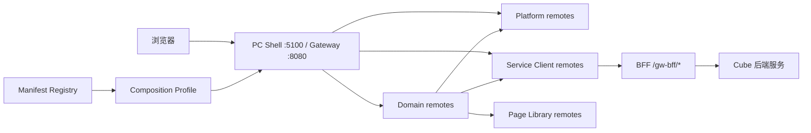

# g2 项目索引

更新时间：2026-08-21

## 项目定位

`g2` 是从旧 `ghcloud` 逐步迁移而来的 Bun + Turborepo 单仓。PC 门面通过 Module Federation 按 Composition Profile 组装 Platform、Service Client、Domain 与 Page Library；旧 qiankun 只作为迁移期兼容桥。

技术栈：Bun 1.3、Turborepo、Vue 3、TypeScript 6、Vite 8、Module Federation、Ant Design Vue、oxlint、oxfmt。

## 目录导航

| 路径                  |        包数量 | 职责                                                             |
| --------------------- | ------------: | ---------------------------------------------------------------- |
| `apps/shells/pc`      |             1 | PC 主应用门面，拥有鉴权状态机、整站路由与组装编排                |
| `apps/domains`        |             4 | 可导航业务域：`access-control`、`daily-task` 和两个 POC 域       |
| `apps/page-libraries` |             1 | 无独立 URL 的共享业务页面库，目前为 `generic-equipment-monitor`  |
| `apps/platforms`      |            19 | UI、HTTP、鉴权、资源、日志、地图、RTC、消息等平台能力 remote     |
| `apps/clients`        |            28 | 按服务面划分的前端 Client remote，固定暴露 `./client`            |
| `contracts`           |            29 | 与 Client/BFF 对齐的纯服务契约                                   |
| `packages`            |             4 | Composition contract、loader、registry、schema                   |
| `bff`                 |             1 | Bun BFF，向浏览器暴露 `/gw-bff/*`                                |
| `tooling`             | 10 个主要工具 | MF 构建、release、依赖治理、文件门禁、迁移脚本                   |
| `deploy`              |             — | Profile、registry、release set、Docker Compose、Nginx 与地址模板 |
| `docs/adr`            |             — | 架构决策记录；架构改动前应先检索这里                             |

`apps/shells/h5`、`apps/platforms/h5-stub`、`apps/standalone` 与 `backends` 当前为预留或骨架，不是现阶段主运行链路。

## 关键入口

| 目的                  | 文件                                             |
| --------------------- | ------------------------------------------------ |
| 根脚本与 workspace    | `package.json`                                   |
| Turbo 任务图          | `turbo.json`                                     |
| PC 门面启动           | `apps/shells/pc/src/main.ts`                     |
| PC 门面 UI/出口       | `apps/shells/pc/src/App.tsx`                     |
| MF 组装 Profile       | `deploy/compositions/prod.pc.yaml`               |
| 本地 remote 注册表    | `deploy/compositions/registry/dev.registry.yaml` |
| 生产发版选集          | `deploy/release-sets/prod.yaml`                  |
| Release CLI           | `tooling/release/src/cli.ts`                     |
| MF Vite 公共配置      | `tooling/mf-vite/src/index.ts`                   |
| Composition 解析/校验 | `packages/composition-schema`                    |
| Runtime remote 装载   | `packages/composition-loader`                    |
| BFF 入口              | `bff/src/main.ts`                                |
| BFF 模块注册          | `bff/src/app.module.ts`                          |
| BFF 配置              | `bff/src/config/app.config.ts`                   |

## 运行时组装关系



核心约束：

- 新 UI 使用 `defineComponent` + TSX + CSS Modules，禁止新增 `.vue`。
- Domain 自持域内 routes，但跨域导航使用 `navigate-intent`，不写死其他域路径。
- Domain 不直接实现 HTTP；服务调用落在 `@g2-client/<surface>`。
- Page Library 不拥有路由和菜单；Domain 通过 `loadPageLibrary` 运行时加载页面，并注入业务参数、权限和导航适配。
- Client 使用 `@g2-contract/<surface>`，通过 `httpPlatform` 访问 BFF。
- BFF controller/proxy 实现 contract Gateway，并限制可转发路径。
- Profile 只声明逻辑名；开发地址在 dev registry，生产地址由 release generate 生成。
- `.deploy-out/`、`dist/` 和 resolved profile 是生成物，不是源码真相。

## Domain / Client / Contract 模板

一个完整业务迁移通常包含：

1. `contracts/<surface>/src/main.ts`：请求、响应及 Gateway 契约。
2. `apps/clients/<surface>/src/client.ts`：固定暴露 `create(ctx)`，封装路径和响应解包。
3. `bff/src/controllers/<surface>` 与 `bff/src/services/proxy/<surface>`：同源 BFF 入口和上游代理。
4. `apps/domains/<domain>/src/domain.ts`：routes、install、菜单贡献和意图入口。
5. 在 `prod.pc.yaml`、dev registry、`prod.yaml` release set 中同时登记。
6. 已迁 qiankun 应用在 `apps/shells/pc/src/filter-migrated-qiankun-apps.ts` 中过滤。

## 当前生产 Profile 中的业务入口

| 类型          | 逻辑名                         | 挂载路径                   |
| ------------- | ------------------------------ | -------------------------- |
| Domain        | `accessControl`                | `/d/access-control`        |
| Domain        | `dailyTask`                    | `/d/daily-task`            |
| Domain        | `pocRemotePc`                  | `/poc-remote`              |
| Inline Domain | `poc-inline-pc`                | `/poc-inline`              |
| Page Library  | `genericEquipmentMonitorPages` | 无独立路径，由 Domain 挂载 |

## daily-task 索引

| 层次             | 路径/逻辑名                                                     |
| ---------------- | --------------------------------------------------------------- |
| Domain           | `apps/domains/daily-task` / `dailyTask` / 开发端口 `5064`       |
| Client           | `apps/clients/daily-task` / `dailyTaskClient` / 开发端口 `5063` |
| Contract         | `contracts/daily-task`                                          |
| BFF base path    | `/gw-bff/daily-task-api`                                        |
| BFF controller   | `bff/src/controllers/daily-task/daily-task.controller.ts`       |
| BFF proxy        | `bff/src/services/proxy/daily-task/daily-task-proxy.service.ts` |
| 上游环境变量     | 本地 `DAILY_TASK_URL`；Docker `BFF_DAILY_TASK_URL`              |
| Domain base path | `/d/daily-task`                                                 |
| 菜单/意图码      | `DAILY_TASK`                                                    |

## 常用命令

```bash
# 安装
bun install

# 日常多端口开发：http://localhost:5100
bun run dev:full

# 单包开发
bun --filter '@g2-domain/daily-task' dev
bun --filter '@g2-client/daily-task' dev

# 质量门禁
bun test
bun run typecheck
bun run lint
bun run fmt:check
bun run validate:compositions
bun run check:deps
bun run check:deps-graph
bun run check:forbidden-files
bun run check:page-libraries

# 全量构建
bun run build

# 仅生成生产发布配置
bun run release:generate -- --set=prod --skip-build

# 本地 MinIO/CDN/Gateway 验收栈：http://localhost:8080
bun run web-release:up
bun run web-release:rebuild
bun run web-release:down
```

## 配置与排错

- 本地 Vite 联调使用 `deploy/compositions/registry/dev.registry.yaml`，不要拿 `.deploy-out/prod/registry.yaml` 替代。
- Compose 配置来源为 `deploy/docker-compose/.env`；模板在 `.env.example`。
- OAuth 登录必须配置 `OAUTH_CLIENT_SECRET`，否则 token 接口会返回 “OAuth client secret is not configured on BFF”。
- 浏览器出现 502 时先检查 gateway → BFF，再检查 BFF 对应 `*_URL` 上游地址。
- `release upload/publish` 出现 `ECONNREFUSED` 时检查 MinIO/对象存储及 `RELEASE_S3_*`。
- `dev:full` 与 `web-release:rebuild` 是两套不同运行栈；前者使用 Vite remote，后者使用发布到 MinIO/CDN 的构建产物。

## 权威文档

- `README.md`：启动、开发与发布操作。
- `CONTEXT.md`：术语、边界和目标架构。
- `docs/adr/0004-repo-layout-apps-role-groups.md`：仓库目录职责。
- `docs/adr/0057-service-triad-contracts-clients-bff.md`：Contract/Client/BFF 三联模型。
- `docs/adr/0058-domain-route-prefix-d-and-appregistrycode.md`：Domain 路由规范。
- `docs/adr/0055-release-generate-deploy-out.md`：发布生成物模型。
- `docs/adr/0049-vue-tsx-no-sfc.md`：TSX/CSS Modules 约束。
