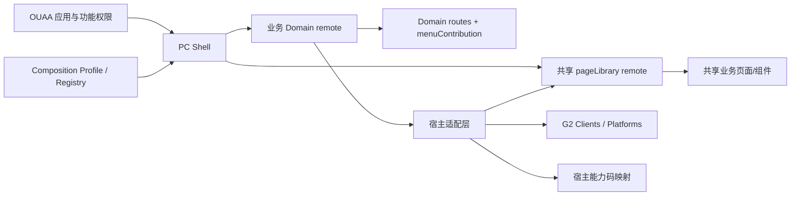

# G2 共享业务页面库能力实施计划

> **For agentic workers:** REQUIRED SUB-SKILL: Use superpowers:executing-plans to implement this plan task-by-task. Steps use checkbox (`- [ ]`) syntax for tracking.

**Goal:** 在 G2 中建立可被多个业务 Domain 复用、由宿主应用自持路由与权限、同时可以独立构建和发布的共享业务页面库机制，并以 `generic-equipment-monitor` 的门禁与安防双宿主作为首个完整落地案例。

**Architecture:** 共享业务页面放入无 `basePath` 的 Module Federation `pageLibrary`；Shell 根据 Composition Profile 注册页面库 remote，并通过 `DomainContext.loadPageLibrary` 提供统一加载入口。消费方 Domain 自己声明 `routes`、`menuContribution`、功能码映射和页面参数适配，页面库只接收稳定的 `pageKey/actionKey`、Client getter、配置与导航回调，不创建 Router，也不拥有菜单和应用权限。

**Tech Stack:** Vue 3、Vue Router 4、TypeScript、Module Federation、Bun workspace、G2 Composition Profile、`@g2-composition/contract`、`@g2-platform/pc-ui`。

---

## 1. 背景与现状判断

旧版 `generic-equipment-monitor-migrate` 是一个完整 qiankun 子应用：

- 自己创建 Vue Router，并声明 `/overView`、`/equipmentMoitorList`、`/alarmRecord` 等公共路由；
- 自己初始化鉴权、播放器和 API；
- 消防、门禁、动环等应用通过不同 `base` 复用该子应用；
- 共享页面可以单独维护，但共享模块同时承担了路由、鉴权、接口和宿主差异，导致应用边界模糊。

G2 已经具备以下基础：

- `apps/page-libraries/generic-equipment-monitor` 已拆为页面库，并 expose 多个业务页面；
- Composition Profile 已有 `pageLibrary` 槽位，registry/release 已能解析和发布页面库 manifest；
- 门禁与安防 Domain 已分别声明自己的路由、菜单、`applicationCode` 和能力码表；
- 页面库已经使用 `pageKey/actionKey + onNavigatePage + Client getter`，没有直接持有宿主 URL。

但当前仍有两个关键缺口：

1. `packages/composition-loader` 的 `CompositionPlan` 没有包含 `pageLibrary`，`composeFromProfile` 也没有将页面库 manifest 注册进 MF runtime。
2. 门禁和安防仍用 `import("@g2-pages/generic-equipment-monitor/...")` 静态引用页面实现，页面最终进入 Domain 构建依赖，无法真正通过 registry 独立切换页面库版本。

因此本计划不是重建一套新机制，而是补齐现有 ADR-0059/0060 的运行时闭环。

## 2. 推荐方案



### 2.1 责任边界

| 能力                               | 归属                      | 说明                                           |
| ---------------------------------- | ------------------------- | ---------------------------------------------- |
| URL、路由名称、路由参数            | 业务 Domain               | 同一共享页在门禁与安防下可以拥有不同 URL       |
| 菜单结构、菜单 entry               | 业务 Domain               | 页面库不输出 `menuContribution`                |
| 应用是否可见、用户功能码           | OUAA/Shell                | 页面库只消费注入结果                           |
| `pageKey/actionKey`                | 页面库契约                | 稳定逻辑键，不包含 URL 和业务功能码值          |
| `pageKey → 本域 URL`               | 业务 Domain               | 由 `page-key-routes.ts` 翻译                   |
| `pageKey/actionKey → functionCode` | 业务 Domain               | 门禁、安防允许映射成不同值                     |
| API 实例、鉴权、租户               | G2 Client + Shell Context | 页面库只接收 getter，不读 sessionStorage/token |
| 纯 UI 控件                         | `apps/platforms/pc-ui`    | 不应放入业务页面库                             |
| 完整可复用业务页面                 | `apps/page-libraries/*`   | 无独立 URL、无 Router、可独立发布              |

### 2.2 不采用的方案

- **不复制旧版独立 Router 子应用：** 会重新引入公共 URL、双重路由、鉴权初始化和菜单归属冲突。
- **不只做 workspace 公共包：** 可以复用源码，但宿主必须重新构建，无法独立发布和回滚。
- **不把页面库伪装成 Domain：** 页面库不应拥有 `basePath`、应用菜单或 OUAA 应用编码。
- **不让后端下发组件路径：** 后端只控制应用/权限/无 path overlay，页面绑定仍由 Domain 契约决定。

## 3. 目标调用方式

### 3.1 Composition Profile

```yaml
pageLibrary:
  - name: genericEquipmentMonitorPages
    logicalName: genericEquipmentMonitorPages

remotes:
  - name: accessControl
    logicalName: accessControl
    basePath: /d/access-control
  - name: securityMonitor
    logicalName: securityMonitor
    basePath: /d/security-monitor
```

`pageLibrary` 不允许配置 `basePath`。

### 3.2 DomainContext 加载契约

```ts
export type PageLibraryLoader = <T = unknown>(libraryName: string, exposedPath: string) => Promise<T>;
export type FunctionCodeProvider = () => ReadonlySet<string>;

export interface DomainContext {
  bus: EventBus;
  getAuthHeaders: AuthHeaderProvider;
  loadPlatform: PlatformLoader;
  loadPageLibrary: PageLibraryLoader;
  getFunctionCodes: FunctionCodeProvider;
  ensureClient: ServiceClientEnsurer;
}
```

### 3.3 页面库契约

```ts
export const GEM_PAGE_KEYS = {
  equipmentMonitorList: "equipmentMonitorList",
  equipmentMonitorDetail: "equipmentMonitorDetail",
  alarmRecord: "alarmRecord",
  alarmDetail: "alarmDetail",
} as const;

export interface GemPageProps {
  applicationCode: string;
  codes: GemCapabilityCodes;
  functionCodes: ReadonlySet<string>;
  onNavigatePage: (payload: PageNavigatePayload) => void;
  getAlarmClient?: () => Promise<AlarmCenterClient>;
  getDeviceClient?: () => Promise<DeviceCenterClient>;
}
```

页面库内部跳转详情时只允许：

```ts
props.onNavigatePage({
  page: GEM_PAGE_KEYS.equipmentMonitorDetail,
  params: { id: record.id },
});
```

禁止页面库调用 `useRouter()` 拼接宿主 URL。

### 3.4 门禁与安防分别挂载同一 expose

```text
/d/access-control/equipmentMonitorList
  → genericEquipmentMonitorPages/EquipmentMonitorList
  → applicationCode=DOORMANAGE
  → ACCESS_CONTROL_GEM_CAPABILITY_CODES

/d/security-monitor/monitoring
  → genericEquipmentMonitorPages/EquipmentMonitorList
  → applicationCode=SECURITY_MONITORING
  → SECURITY_MONITOR_GEM_CAPABILITY_CODES
```

页面实现相同，URL、菜单、权限码和业务配置属于各自 Domain。

---

## 4. 文件结构

| 路径                                                            | 职责                                                  |
| --------------------------------------------------------------- | ----------------------------------------------------- |
| `apps/page-libraries/generic-equipment-monitor/src/contract.ts` | 页面键、动作键、公共 Props 与 expose 模块类型         |
| `apps/page-libraries/generic-equipment-monitor/src/pages/*`     | 无路由感知的共享业务页面                              |
| `apps/page-libraries/generic-equipment-monitor/vite.config.ts`  | MF exposes                                            |
| `packages/composition-loader/src/build-composition-plan.ts`     | 把 Profile `pageLibrary` 纳入运行计划                 |
| `apps/shells/pc/src/compose-from-profile.ts`                    | 注册页面库 remote 并提供 loader                       |
| `packages/composition-contract/src/types.ts`                    | `DomainContext.loadPageLibrary/getFunctionCodes` 契约 |
| `apps/domains/access-control/src/mount-gem-page.tsx`            | 门禁宿主参数、权限、导航和 Client 注入                |
| `apps/domains/security-monitor/src/mount-gem-page.tsx`          | 安防宿主参数、权限、导航和 Client 注入                |
| `apps/domains/*/src/domain.ts`                                  | 宿主 URL 与菜单                                       |
| `deploy/compositions/prod.pc.yaml`                              | 页面库逻辑名选集                                      |
| `deploy/release-sets/prod.yaml`                                 | 页面库构建/上传单元                                   |

---

## 5. 实施任务

### Task 1: CompositionPlan 纳入 pageLibrary

**Files:**

- Modify: `packages/composition-loader/src/build-composition-plan.ts`
- Modify: `packages/composition-loader/src/build-composition-plan.test.ts`

- [ ] **Step 1: 先写失败测试**

新增断言：输入 Profile 含 `pageLibrary: [{ name: "gemPages", entry: "http://localhost:5051/mf-manifest.json" }]` 时，计划输出对应 entry ref，且不带 `basePath`。

- [ ] **Step 2: 运行测试确认失败**

Run:

```bash
bun test packages/composition-loader/src/build-composition-plan.test.ts
```

Expected: FAIL，`plan.pageLibraries` 不存在。

- [ ] **Step 3: 扩展 CompositionPlan**

```ts
export interface CompositionPlan {
  facade: CompositionProfile["facade"];
  env: string;
  platforms: CompositionRef[];
  clients: CompositionRef[];
  pageLibraries: CompositionRef[];
  inline: DomainPackageRef[];
  remotes: DomainEntryRef[];
}
```

在 `buildCompositionPlan()` 中加入：

```ts
pageLibraries: (profile.pageLibrary ?? []).map(toPlatformRef),
```

- [ ] **Step 4: 运行测试确认通过**

```bash
bun test packages/composition-loader/src/build-composition-plan.test.ts
```

- [ ] **Step 5: 提交**

```bash
git commit -m "feat(composition-loader): include page libraries in composition plan"
```

### Task 2: Shell 注册并加载 pageLibrary remote

**Files:**

- Modify: `apps/shells/pc/src/compose-from-profile.ts`
- Modify: `apps/shells/pc/src/compose-from-profile.test.ts`
- Modify: `packages/composition-contract/src/types.ts`
- Modify: `packages/composition-contract/src/test-harness.ts`
- Modify: `apps/shells/pc/src/main.ts`

- [ ] **Step 1: 写 MF 注册失败测试**

构造含 `pageLibrary` 的 resolved profile，断言 `mf.registerRemotes()` 收到：

```ts
{
  name: "genericEquipmentMonitorPages",
  entry: "http://localhost:5051/mf-manifest.json",
  type: "module",
}
```

- [ ] **Step 2: 写 loader 测试**

断言：

```ts
await composition.loadPageLibraryExposed("genericEquipmentMonitorPages", "EquipmentMonitorList");
```

最终调用 MF：

```ts
mf.loadRemote("genericEquipmentMonitorPages/EquipmentMonitorList");
```

- [ ] **Step 3: 注册 pageLibraries**

在 platform/client/domain remote 注册之后加入页面库注册循环，并校验所有 MF remote 名在四类槽位中唯一，重名时启动失败并列出冲突槽位。

- [ ] **Step 4: 扩展上下文**

向 `DomainContext` 增加：

```ts
loadPageLibrary: PageLibraryLoader;
getFunctionCodes: FunctionCodeProvider;
```

Shell 注入：

```ts
ctx = {
  bus: createEventBus(),
  getAuthHeaders: () => buildAuthHeaders(...),
  loadPlatform: composition.loadPlatformExposed,
  loadPageLibrary: composition.loadPageLibraryExposed,
  getFunctionCodes: () => new Set(useFunctionCodesStore().list()),
  ensureClient: (clientName) => composition.ensureClient(clientName, ctx),
};
```

同步为 `function-codes` store 增加只读 `list()`，不得让 Domain 直接依赖 Shell Pinia store。

- [ ] **Step 5: 更新 fake context 和全部编译点**

默认 fake loader 应抛出明确错误；默认 `getFunctionCodes()` 返回空 Set。

- [ ] **Step 6: 验证**

```bash
bun test packages/composition-contract packages/composition-loader apps/shells/pc/src/compose-from-profile.test.ts
bun run --filter @g2-shell/pc typecheck
```

- [ ] **Step 7: 提交**

```bash
git commit -m "feat(shell-pc): register and expose page-library remotes"
```

### Task 3: 固化页面库公共契约边界

**Files:**

- Create: `apps/page-libraries/generic-equipment-monitor/src/contract.ts`
- Modify: `apps/page-libraries/generic-equipment-monitor/src/index.ts`
- Modify: `apps/page-libraries/generic-equipment-monitor/package.json`
- Modify: `apps/page-libraries/generic-equipment-monitor/vite.config.ts`
- Test: `apps/page-libraries/generic-equipment-monitor/src/contract.test.ts`

- [ ] **Step 1: 新建 contract 入口**

统一从 `contract.ts` 导出 `GEM_PAGE_KEYS`、`GEM_ACTION_KEYS`、`GemCapabilityCodes`、`PageNavigatePayload`、`NavigatePage` 和页面 Props 类型。

- [ ] **Step 2: 增加 package export**

```json
{
  "exports": {
    "./contract": "./src/contract.ts"
  }
}
```

Domain 只允许静态导入 `@g2-pages/generic-equipment-monitor/contract`；页面实现必须通过 runtime loader 获取。

- [ ] **Step 3: 增加兼容性测试**

测试所有 page key/action key 唯一且不可为空；对现有 key 做快照，防止页面库独立升级时无意破坏旧宿主。

- [ ] **Step 4: 增加边界扫描**

页面库源码必须满足：

```bash
! rg 'useRouter|createRouter|router\.push|sessionStorage|localStorage' apps/page-libraries/generic-equipment-monitor/src
```

允许 Client 的 `import type`，不允许页面自行创建带 token 的 HTTP Client。

- [ ] **Step 5: 验证并提交**

```bash
bun run --filter @g2-pages/generic-equipment-monitor test
bun run --filter @g2-pages/generic-equipment-monitor build
git commit -m "refactor(generic-equipment-monitor): isolate page-library contract"
```

### Task 4: 门禁改为运行时挂载页面库

**Files:**

- Modify: `apps/domains/access-control/src/domain.ts`
- Modify: `apps/domains/access-control/src/mount-gem-page.tsx`
- Modify: `apps/domains/access-control/src/domain-context.ts`
- Modify: `apps/domains/access-control/src/capability-codes.ts`
- Modify: `apps/domains/access-control/src/domain.install.test.ts`
- Modify: `apps/domains/access-control/src/page-key-routes.test.ts`

- [ ] **Step 1: 写宿主 loader 测试**

访问门禁 `equipmentMonitorList` route 时，断言宿主请求：

```ts
loadPageLibrary("genericEquipmentMonitorPages", "EquipmentMonitorList");
```

并注入：

```ts
{
  applicationCode: "DOORMANAGE",
  codes: ACCESS_CONTROL_GEM_CAPABILITY_CODES,
  functionCodes: ctx.getFunctionCodes(),
}
```

- [ ] **Step 2: 将页面导入改为 expose 名称**

把：

```ts
hostGemPage(() => import("@g2-pages/generic-equipment-monitor/EquipmentMonitorList"), options);
```

改为：

```ts
hostGemPage("EquipmentMonitorList", options);
```

`mount-gem-page.tsx` 内部通过 `installCtx.loadPageLibrary()` 加载 `{ default: Component }`。

- [ ] **Step 3: 移除 DEV_ALL_CODES**

页面权限必须来自 `ctx.getFunctionCodes()`；开发全量放行只能通过明确的 dev fixture 注入，生产路径禁止默认全开。

- [ ] **Step 4: 保持门禁路由不变**

必须继续兼容：

- `/d/access-control/equipmentMonitorList`
- `/d/access-control/equipmentMoitorList`
- `/d/access-control/alarmRecord`
- `/d/access-control/alarmConfigList`

- [ ] **Step 5: 验证**

```bash
bun run --filter @g2-domain/access-control test
bun run --filter @g2-domain/access-control typecheck
bun run --filter @g2-domain/access-control build
```

- [ ] **Step 6: 提交**

```bash
git commit -m "refactor(access-control): load GEM pages from page-library runtime"
```

### Task 5: 安防作为第二个宿主接入

**Files:**

- Modify: `apps/domains/security-monitor/src/domain.ts`
- Modify: `apps/domains/security-monitor/src/mount-gem-page.tsx`
- Modify: `apps/domains/security-monitor/src/capability-codes.ts`
- Modify: `apps/domains/security-monitor/src/domain.install.test.ts`
- Modify: `apps/domains/security-monitor/src/page-key-routes.test.ts`

- [ ] **Step 1: 写双宿主差异测试**

同一个 `EquipmentMonitorList` expose：

- 门禁注入 `DOORMANAGE` 和门禁功能码表；
- 安防注入 `SECURITY_MONITORING` 和安防功能码表；
- 两个 Domain 解析出的 URL 不同。

- [ ] **Step 2: 改为运行时加载**

安防 route 使用：

```ts
hostGemPage("EquipmentMonitorList", {
  pageProps: { title: "监控权限" },
});
```

- [ ] **Step 3: 使用真实 functionCodes**

删除安防宿主的 `DEV_ALL_CODES`，缺失能力码时默认隐藏功能。

- [ ] **Step 4: 验证**

```bash
bun run --filter @g2-domain/security-monitor test
bun run --filter @g2-domain/security-monitor typecheck
bun run --filter @g2-domain/security-monitor build
```

- [ ] **Step 5: 提交**

```bash
git commit -m "refactor(security-monitor): host GEM through shared page library"
```

### Task 6: 加载失败、版本兼容与回滚

**Files:**

- Create: `apps/shells/pc/src/page-library-loader-error.ts`
- Modify: `apps/shells/pc/src/compose-from-profile.ts`
- Modify: `apps/domains/access-control/src/mount-gem-page.tsx`
- Modify: `apps/domains/security-monitor/src/mount-gem-page.tsx`
- Modify: `deploy/release-sets/prod.yaml`
- Test: `apps/shells/pc/src/compose-from-profile.test.ts`

- [ ] **Step 1: 定义明确错误信息**

错误必须包含 library、expose 和 manifest entry，例如：

```text
page library "genericEquipmentMonitorPages/AlarmRecord" failed to load from .../mf-manifest.json
```

- [ ] **Step 2: 页面级错误态**

宿主显示 `共享页面加载失败`、错误摘要和“重新加载”按钮，不让整个 Shell 白屏。

- [ ] **Step 3: 契约版本**

页面库 expose `./contractInfo`：

```ts
export const contractInfo = {
  name: "generic-equipment-monitor",
  major: 1,
};
```

宿主加载页面前校验 major；major 不匹配时拒绝渲染并给出可诊断错误。

- [ ] **Step 4: 发布与回滚**

页面库独立构建上传后，只更新 registry：

```yaml
genericEquipmentMonitorPages: genericEquipmentMonitorPages/<version>/mf-manifest.json
```

回滚只需把 registry 指回上一版本并重新 resolve/publish；已打开页面刷新后生效，不承诺运行中无刷新热替换。

- [ ] **Step 5: 验证错误路径**

测试 manifest 404、expose 不存在、contract major 不匹配三种情况。

- [ ] **Step 6: 提交**

```bash
git commit -m "feat(page-library): add runtime diagnostics and contract guard"
```

### Task 7: 建立新页面库模板和架构守卫

**Files:**

- Create: `apps/page-libraries/README.md`
- Create: `tooling/page-library-check/src/cli.ts`
- Create: `tooling/page-library-check/src/cli.test.ts`
- Create: `tooling/page-library-check/package.json`
- Modify: root `package.json`
- Modify: `docs/project-index.md`

- [ ] **Step 1: 写页面库模板文档**

规定新页面库至少包含：

```text
apps/page-libraries/<name>/
├── package.json
├── vite.config.ts
└── src/
    ├── contract.ts
    ├── index.ts
    ├── pages/
    └── components/
```

- [ ] **Step 2: 增加静态守卫**

检查所有 `apps/page-libraries/*`：

- 不得依赖 `apps/domains` 或 `apps/shells`；
- 不得调用 `createRouter/useRouter/router.push`；
- 不得读写 token、租户 sessionStorage；
- Profile `pageLibrary` 项不得有 `basePath`；
- MF expose 名不可重复。

- [ ] **Step 3: 接入根命令**

```json
{
  "scripts": {
    "check:page-libraries": "bun run --filter @g2-tooling/page-library-check check"
  }
}
```

- [ ] **Step 4: 验证并提交**

```bash
bun run check:page-libraries
bun run validate:compositions
git commit -m "chore(architecture): enforce page-library boundaries"
```

### Task 8: 端到端发布验收

**Files:**

- Verify: `.deploy-out/prod/registry.yaml`
- Verify: `.deploy-out/prod/resolved.json`
- Verify: `apps/page-libraries/generic-equipment-monitor/dist/mf-manifest.json`

- [ ] **Step 1: 全量测试**

```bash
bun run --filter @g2-composition/loader test
bun run --filter @g2-composition/contract test
bun run --filter @g2-pages/generic-equipment-monitor test
bun run --filter @g2-domain/access-control test
bun run --filter @g2-domain/security-monitor test
```

- [ ] **Step 2: 构建四个产物**

```bash
bun run --filter @g2-pages/generic-equipment-monitor build
bun run --filter @g2-domain/access-control build
bun run --filter @g2-domain/security-monitor build
bun run --filter @g2-shell/pc build
```

- [ ] **Step 3: 发布并检查 resolved profile**

```bash
bun run release:generate
rg 'genericEquipmentMonitorPages|accessControl|securityMonitor' .deploy-out/prod/registry.yaml .deploy-out/prod/resolved.json
```

Expected: 三个 remote 指向各自独立 manifest，page library 没有 `basePath`。

- [ ] **Step 4: 浏览器验收**

1. 访问 `/d/access-control/equipmentMonitorList`，确认加载 GEM 页面、门禁标题和门禁接口参数。
2. 访问 `/d/security-monitor/monitoring`，确认加载同一 expose、安防标题和 `SECURITY_MONITORING` 参数。
3. 验证两个页面的按钮权限随 OUAA functionCodes 不同而变化。
4. 只发布一个新的 GEM 页面库版本，不重建两个 Domain；更新 registry 并刷新后确认两个宿主都使用新版本。
5. 将 registry 回滚到前一版本，刷新后恢复。

---

## 6. 分阶段上线建议

| 阶段 | 内容                          | 风险                          | 回滚点                |
| ---- | ----------------------------- | ----------------------------- | --------------------- |
| P0   | Task 1–2，补齐 runtime loader | 低，不改页面 URL              | 恢复静态导入          |
| P1   | Task 3–4，门禁先接入          | 中，验证权限与详情跳转        | 门禁 manifest 回滚    |
| P2   | Task 5，安防成为第二宿主      | 中，验证 applicationCode 差异 | 安防 manifest 回滚    |
| P3   | Task 6–7，错误态与守卫        | 低                            | 单独回滚工具/错误态   |
| P4   | Task 8，独立版本切换验收      | 中，涉及 registry             | registry 指回上一版本 |

不要一次性把所有旧公共模块都迁成页面库。先用 GEM 闭合加载、权限、导航、发布和回滚，再评估下一个候选模块。

## 7. 页面库候选判定标准

满足以下条件时才放入 `apps/page-libraries`：

1. 至少两个 Domain 复用同一业务页面或完整业务组件；
2. 页面业务逻辑和交互主体相同，宿主差异能通过 Props/Client/config 表达；
3. 页面不需要拥有独立 OUAA 应用身份；
4. 页面不依赖固定 URL；
5. 页面具备独立发布和回滚价值。

以下情况不应创建页面库：

- 只有颜色、按钮或表格等纯 UI 复用：进入 `pc-ui`；
- 是播放器、地图、图表 SDK 等技术能力：进入 Platform；
- 只是接口 DTO/请求复用：进入 contract/client；
- 只有一个 Domain 使用且没有明确第二个消费者：保留在 Domain 内。

## 8. 验收标准

- [ ] `pageLibrary` 被 composition runtime 注册，不再只是 schema/release 元数据。
- [ ] 门禁和安防页面实现不再静态导入 GEM 页面文件。
- [ ] 同一 expose 可挂到两个不同 Domain URL。
- [ ] 页面库源码不包含 Router、菜单、宿主 application code、token/session 初始化。
- [ ] 页面库内部导航全部使用 `pageKey + params`。
- [ ] 功能权限来自 Shell/OUAA，生产环境不存在 `DEV_ALL_CODES` 全量放行。
- [ ] 页面库可单独发版；兼容版本切换无需重新构建宿主 Domain。
- [ ] manifest/expose 加载失败有页面级错误提示和日志。
- [ ] registry 可独立回滚页面库版本。

## 9. 最终结论

G2 中应实现的是“共享业务页面库”，不是复制一个拥有公共路由的旧式共享子应用。共享页面库负责页面实现，业务 Domain 负责 URL、菜单、权限映射和宿主差异，Shell/Composition 负责按 registry 版本加载。现有 GEM 已经完成大部分代码拆分，本计划优先补齐 runtime 加载和真实权限两处缺口，即可达到旧版独立管理能力，同时避免旧版路由和鉴权耦合。
